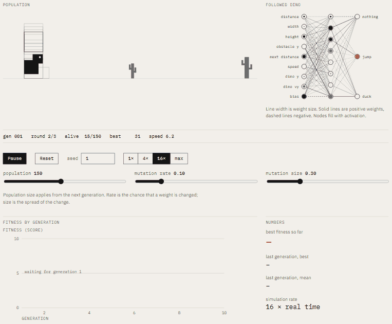

# Dino neuroevolution

Small neural networks learn to play a clone of the Chrome Dino game by neuroevolution. This repository holds a deterministic simulation in Python and TypeScript, four learning methods and a hand-written baseline compared over 10 seeds each, and a browser page that evolves a population live.



Live demo: TBD. `vercel.json` configures a Vercel deployment: import the repository in Vercel, leave the root directory at the repository root, and every push is built after the web tests (including the parity test) pass. I have not deployed it yet, so there is no address to give. The site has four pages: live evolution, watch an agent, results, and how it works.

## Results

| Algorithm | Best run | Mean ± 95% CI | Steps to 1,000 points | Generations | Wall-clock per run (s) |
| :--- | ---: | ---: | ---: | ---: | ---: |
| rule, fixed | 712 | 684 ± 42 | - | - | 1 |
| rule, scaled | 3,202 | 3,178 ± 55 | - | - | 7 |
| PPO | 10,869 | 3,182 ± 2,773 | 1.02 M (10 of 10 runs) | - | 1,974 |
| CMA-ES | 6,757 | 2,252 ± 1,600 | 9.28 M (6 of 10 runs) | 153 | 359 |
| GA | 11,087 | 4,558 ± 2,722 | 9.43 M (10 of 10 runs) | 48 | 321 |
| NEAT | 11,087 | 8,033 ± 2,049 | 4.34 M (10 of 10 runs) | 26 | 304 |

Each row is 10 independent runs. The score is the mean over 100 seeds that no method trained or was tuned on, in the full 36,000-tick game, where the highest possible score is 11,087. "Best run" is the single best run's mean. "Steps to 1,000 points" counts environment steps (one per game tick) until a generation's best fitness first reached that score. Intervals are 95% t-intervals over runs and are wide. NEAT has the highest mean score, and a permutation test against the GA gives p = 0.036, which is weak evidence once 12 comparisons are made. The comparisons that stand out are elitism switched off in the GA (p < 0.001) and NEAT against CMA-ES (p < 0.001). The report has the full table of tests and says which ones I would not rely on.

## How it works

The game is a fixed-timestep clone of the Dino game, written from scratch. A dino stands, jumps or ducks. Cacti come in two sizes and in groups of up to three, birds fly at three heights, and the speed rises from 6 to 13 pixels per tick over about 7,000 ticks. Each tick the network receives nine numbers, all scaled to roughly 0 to 1: the distance to the next obstacle and its width, height and height above ground, the distance to the one after it, the game speed, the dino's height and vertical velocity, and a constant 1. It picks the action with the largest output: nothing, jump or duck. Python and TypeScript run the same rules, and 2,557 sampled game states and 12 network test vectors check that they agree.

The genetic algorithm keeps 150 genomes, each a vector of 96 weights for a network with 8 tanh hidden units. A generation plays every genome on 3 random seeds and scores it by the mean, selects parents by tournament, mixes two parents weight by weight, and perturbs some weights with Gaussian noise. The best 8 genomes are copied across unchanged. Averaging over seeds matters because the obstacle sequence is random: a genome that happens to meet an easy sequence would otherwise outbreed a better one. Of the GA settings I changed, elitism is the only one whose effect stands out from run-to-run variation. With it off, the GA's mean test score was 402 against 4,558 with it on.


Three other methods train the same task. CMA-ES adapts a Gaussian over the same 96 weights from the ranking of each sample. NEAT evolves the network's topology and weights together, starting from inputs wired straight to outputs. PPO, from Stable-Baselines3, learns a 64 by 64 policy by gradient steps on the same observations. They are compared by environment steps, the number of game ticks simulated during training, so that a method that is cheap per step is not credited for it. A rule that jumps when an obstacle is within a tuned distance is the floor: the fixed-distance version scored 684 and a version whose distance grows with speed scored 3,178.

## How to reproduce

You need [uv](https://docs.astral.sh/uv/) (it installs Python 3.11), Node 22 or later, and `make`. On Windows, run the `make` recipes' commands directly if `make` is missing.

```
make setup          # Python environment (CPU-only PyTorch)
make lint test      # ruff, then the Python tests (which include the parity fixture check)
make web-setup      # npm packages for the web app
make web-check      # lint, typecheck, tests (with the parity test) and a production build
make web-dev        # the web app on a local server
```

Quick mode runs every algorithm and three of the GA ablations at small budgets on 3 seeds. It is 27 jobs and 1,117 CPU-seconds on my machine, so about 4.7 minutes on four cores. It shows that the pipeline works and gives rough numbers, not final ones.

```
make quick
```

The full experiments are the main comparison (10 seeds per algorithm, 20 million environment steps for the evolutionary methods and 5 million for PPO) and the GA ablations. Together they were 140 jobs and 15.1 CPU-hours on my machine. Interrupted suites resume where they stopped.

```
make experiments    # results/main and results/ablations
make figures        # report/figures and report/tables, from results/
make docs           # this README and report/REPORT.md, from results/
```

The animation above is captured from the production build by `web/scripts/capture-frames.mjs` and assembled by `make gif`.

Every result in this README and the report, and every figure, is generated from the files in `results/`. The prose around the numbers is written by hand; the numbers in it are placeholders that `make docs` fills in.

## Repository layout

```
sim/                  Python: the game, the algorithms and the experiment pipeline
  game.py             deterministic, seeded, fixed-timestep game (the reference)
  network.py          the 9-8-3 network; genome_io.py reads and writes genome files
  algorithms/         ga.py, cmaes.py, neat_runner.py (+ neat_config.ini), ppo_baseline.py, rule_based.py
  experiments/        suites/*.yaml, the runner, aggregation, notes on what did not work
  analysis/           learning curves, decision probes, generalisation replay
  figures/            SVG figure writer, figure and table builder, README and report generator
  tests/              pytest suite, golden traces for the parity test
web/                  TypeScript, Vite, Canvas 2D, no UI framework
  src/sim/            port of game.py, checked against the same golden traces
  src/evolve/         in-browser GA, trainer and genome readers
  src/render/         population canvas, network drawing, charts, figure interactions
  src/pages/          live evolution, watch an agent, results, how it works
results/              generated run files, best genomes and benchmarks
report/               REPORT.md, templates, figures (SVG) and tables
```

## What did not work

My first version of the game used the original Dino game's gap between obstacles (coefficient 0.6). A speed-aware rule tuned on 20 seeds then scored 4,867 on the 100 test seeds, 44% of the highest possible score, and survived to the cap on 12 of 100. In my first measurement, with a shorter episode cap, that rule reached the cap on most seeds, which would have left the learning methods nothing to improve on. I changed the coefficient to 0.5 and raised the cap to 36,000 ticks. The same rule now scores 3,202 (29%) and reaches the cap on 4 of 100. I could not show that every seed is winnable: a search for surviving action paths pruned too many states and failed even on the original setting, so I dropped it.

PPO with my first settings (learning rate 3e-4, discount 0.995) did not learn. The mean training episode score was 33 in the first window and 34 after 501,760 steps. With learning rate 1e-3 and discount 0.99, the same measurement reached 394. I chose those settings after comparing 5 settings on one seed for 2 million steps each; the training score at the end was 458 for the one I kept and 41 to 372 for the others. That is light tuning.

NEAT's speciation threshold of 3.0 produced 1 species in every generation, so there was nothing to log or protect. A threshold of 1.0 gave up to 14. My first NEAT export disagreed with neat-python's own network on a small share of decisions, because neat-python 2.0.0 treats nodes with no incoming connections as constants. I now export neat-python's own evaluation plan, and the test suite compares the exported plan with neat-python's network decision by decision on evolved genomes.

Training at the game's full 36,000-tick cap would have made one generation of 150 competent genomes cost 16 million environment steps, so training episodes stop at 12,000 ticks. The consequence is that the best training fitness is capped at 3,287 and that final genomes have to be tested separately at the full length.

## Limitations and future work

The comparison is one game on one machine, with 10 runs per method. The intervals are wide, and most differences between the GA, PPO, CMA-ES and the speed-aware rule are within them. Only PPO had its settings compared at all, apart from NEAT's speciation threshold. The GA, CMA-ES and NEAT otherwise use first-guess parameters. The "best" curves are not the same quantity across methods (best genome on three seeds for the evolutionary methods, best episode in a window for PPO), so the report compares levels only on unseen seeds. The best genome of a run is chosen by its score on three training seeds, and it loses 25% of that score on unseen seeds for the GA at the training cap. There is no git history yet, so run files record `commit: unknown`.

I measured the web page in one browser: Edg/157.0.4341.60, headless, with software rendering, on AMD Ryzen 7 7735HS with Radeon Graphics. It held 60.0 frames per second with 300 dinos and a 99th-percentile frame of 16.8 ms. I have not run it in Firefox or on a laptop-class machine.

Next steps I would take: choose each run's final genome on a separate validation set of seeds instead of its training seeds; give every method the same tuning effort; add a noise handler to CMA-ES; run more seeds so the intervals narrow; and add an evolution strategy in the style of Salimans et al. to the comparison.

## References

- Stanley, K. O. and Miikkulainen, R. (2002). Evolving neural networks through augmenting topologies. *Evolutionary Computation* 10(2), 99-127.
- Salimans, T., Ho, J., Chen, X., Sidor, S. and Sutskever, I. (2017). Evolution strategies as a scalable alternative to reinforcement learning. arXiv:1703.03864.
- Hansen, N. (2016). The CMA evolution strategy: a tutorial. arXiv:1604.00772.
- Schulman, J., Wolski, F., Dhariwal, P., Radford, A. and Klimov, O. (2017). Proximal policy optimization algorithms. arXiv:1707.06347.

## Licence

MIT. See `LICENSE`.
